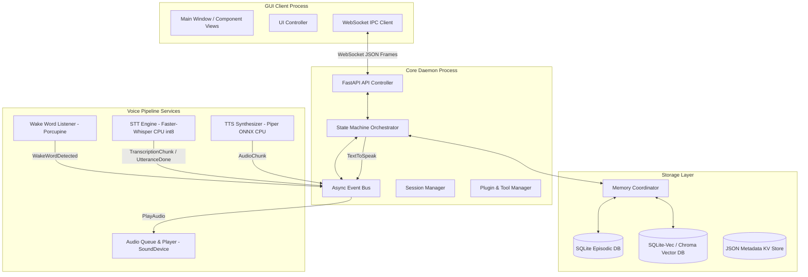

# CREED: Unified Architecture, Analysis, and Milestone Roadmap

## 1. Document Purpose & Project Context
This document serves as the master blueprint for **CREED**, a modular, offline-first personal AI assistant. 

### Scope & Execution Target
* **Target Audience**: Single-User Software (optimized for the owner's local PC, and structured for future migration to a mobile deployment).
* **Hardware Constraint**: **Strict CPU-Only Execution**. The system must run efficiently without Nvidia CUDA or dedicated GPU hardware (optimized for Intel UHD 630 integrated graphics and standard CPU architectures).
* **Core Optimization Strategy**:
  1. **STT**: `Faster-Whisper` running on CPU utilizing `int8` quantization.
  2. **TTS**: `Piper` running with single-threaded ONNX CPU execution.
  3. **LLM**: Local model inference (Ollama) targeting quantized `4-bit` weights (e.g. `llama3-q4_K_M` or `phi3-q4_K_M`).

---

## 2. Project Audit & Rating

Here is a rating of the current prototype codebase across critical engineering dimensions:

| Factor | Rating | Key Issue |
| :--- | :--- | :--- |
| **Concurrency & Thread Safety** | **2/10** | Global mutable state. The backend uses a single `CreedEngine` instance with a shared `history` array; concurrent tab/client requests will mix or corrupt histories. |
| **I/O & Processing Efficiency** | **3/10** | Synchronous and blocking. Network requests and subprocess execution (Ollama API, Piper execution) block the thread, leading to potential GUI lag. |
| **Voice Pipeline Readiness** | **4/10** | The wake-word listener is run in a separate thread but lacks integration with the GUI or an audio capture engine. Speech-to-text is completely absent. |
| **SOLID Adherence & Quality** | **3/10** | The GUI's `MainWindow` is a monolithic wrapper mixing styles, threading, UI components, and API routing. High coupling prevents component isolation. |
| **Extensibility & Plugins** | **3/10** | Adding capability modules requires statically writing imports inside the orchestrator rather than using a discovery-based plugin registry. |
| **Real-World Utility (Single-User)** | **2/10** | The prototype acts as a static terminal-to-UI proxy. It is not yet ready for daily assistant workflows. |

---

## 3. Identified Architectural Problems & Gaps

1. **Assistant History Truncation Bug (Critical)**: In [core/engine.py#L44](file:///D:/CREED/creed/core/engine.py#L44), the engine appends `full_response` to the conversational history, but `full_response` is defined as `""` and never populated during inference. This results in the assistant's context history storing empty responses, causing the LLM to lose conversational continuity.
2. **Dormant Intent Routing**: The `IntentRouter` is loaded and modules are registered in [core/engine.py](file:///D:/CREED/creed/core/engine.py#L82), but the engine's `stream_response` never dispatches input to the router. All prompts bypass local tools (like memory and system) and go straight to the LLM.
3. **No True LLM Streaming**: Ollama in [modules/ai.py](file:///D:/CREED/creed/modules/ai.py) is queried with `"stream": False`. The HTTP call is synchronous and blocking. The backend yields the entire response in a single block rather than streaming tokens chunk-by-chunk.
4. **TTS Interruption Blocking**: The `stop()` function in [modules/tts.py#L27](file:///D:/CREED/creed/modules/tts.py#L27) only empties the text queue. Because the audio playback uses blocking `sd.wait()`, clicking "Stop" in the GUI or sending a new message does not immediately stop Piper's currently playing audio.
5. **Broken UI Scroll Assignment**: In [gui/main_window.py#L84](file:///D:/CREED/creed/gui/main_window.py#L84), `self.chat_scroll = self.setObjectName("chat_area")` reassigns the layout object to `None` since `setObjectName()` has no return value.
6. **Inactive UI elements**: The microphone button (`voice_btn`), the memory panel, and the system status panels in [gui/main_window.py](file:///D:/CREED/creed/gui/main_window.py) are completely static or disconnected.

---

## 4. Architectural Design Blueprint (Target)

The target architecture is designed as a **decoupled headless daemon** communicating with an isolated **GUI Client** using asynchronous WebSocket Inter-Process Communication (IPC).

### Dependency Inversion Rules
1. **No Hardcoded Clients**: The Orchestrator depends on abstract interface definitions (`BaseAIProvider`, `BaseSpeechService`). Concrete implementations are injected at boot.
2. **Event Isolation**: Subsystems do not call each other directly; they subscribe to and publish events on the central asynchronous `EventBus`.
3. **Zero GUI Logic in Core**: The core daemon has no references to PySide6 or Qt.

---

## 5. Technical Milestones & Roadmap

### Milestone 1: Session Isolation & Core Abstractions (Core Stability)
* **Goal**: Establish a thread-safe, multi-session backend foundation, resolve memory context leakage, and isolate dependencies with clean interfaces.
* **Deliverables**:
  * Stateless `CreedEngine` receiving conversation history payloads dynamically.
  * Isolated `SessionState` scopes mapping client states.
  * Abstract base interfaces for AI and Speech modules.
* **Duration**: 3-4 Days | **Difficulty**: 6/10 | **Risk**: High
* **Testing Checklist**:
  - [ ] Trigger parallel chat requests and verify zero context bleeding.
  - [ ] Run CLI mode and check basic execution.
* **Definition of Done**: Multiple clients can call `/chat` concurrently without mutating global state. Unit tests pass with 80%+ coverage.

### Milestone 2: Asynchronous Conversion & Database Upgrade
* **Goal**: Eliminate blocking threads during long-running network calls and implement a non-blocking asynchronous storage database.
* **Deliverables**:
  * Async Ollama and Groq adapters using `httpx.AsyncClient`.
  * Async TTS running Piper via non-blocking subprocess commands.
  * SQLite database integration for episodic conversation tracking.
* **Duration**: 2-3 Days | **Difficulty**: 5/10 | **Risk**: Medium
* **Testing Checklist**:
  - [ ] Confirm backend doesn't hang during simulated long network delays.
  - [ ] Validate SQLite concurrent write queues.
* **Definition of Done**: All HTTP, subprocess, and database queries are fully non-blocking.

### Milestone 3: GUI Modularization & QSS Styling
* **Goal**: Clean up the user interface layer, decouple the monolithic main window, and connect components dynamically.
* **Deliverables**:
  * Extracted styling file `gui/styles/theme.qss`.
  * Isolated UI components under `gui/components/` (`ChatView`, `StatusBar`, `InputBar`, `VoiceIndicator`).
  * WebSocket integration on the client to handle real-time token rendering.
* **Duration**: 2 Days | **Difficulty**: 4/10 | **Risk**: Low
* **Testing Checklist**:
  - [ ] Ensure custom styles load and compile cleanly.
  - [ ] Verify scrolling behaves correctly when rendering chat bubbles.
* **Definition of Done**: `main_window.py` contains no style strings and holds under 150 lines of layout glue code.

### Milestone 4: Async Event Bus & Voice Pipeline Integration
* **Goal**: Build the real-time event-driven loop that binds the wake-word engine, speech-to-text, LLM, and text-to-speech with instant interruption logic.
* **Deliverables**:
  * Asynchronous Pub/Sub Event Bus.
  * Local CPU-optimized `Faster-Whisper` STT engine.
  * Interruption handler that terminates active audio output in under 100ms.
* **Duration**: 5-6 Days | **Difficulty**: 8/10 | **Risk**: High
* **Testing Checklist**:
  - [ ] Speak the wake word and confirm voice capture state transitions.
  - [ ] Speak or type while speech is playing. Confirm output silences instantly.
* **Definition of Done**: End-to-end voice loop works. Users can trigger the assistant via wake word, receive speech output, and interrupt voice output in real-time.

### Milestone 5: Production Packaging, RAG & Extensions
* **Goal**: Enable local tool execution, document search (RAG), and compile the application for cross-platform distribution.
* **Deliverables**:
  * Dynamic `PluginManager` executing local python tools.
  * Local vector search index (`sqlite-vec` or `chromadb`) supporting PDF ingestion.
  * PyInstaller or Briefcase configurations bundling the app into an offline Windows installer.
* **Duration**: 4 Days | **Difficulty**: 5/10 | **Risk**: Medium
* **Testing Checklist**:
  - [ ] Install packaged `.exe` on a fresh offline computer and run it.
  - [ ] Ingest a PDF and confirm vector search accuracy.
* **Definition of Done**: App compiles into a single executable installer that manages its own weights and runs fully offline.

---

## 6. Recommended Actionable Improvements (Action Steps)

1. **Enable LLM Streaming**: Rewrite the AI adapters to request streaming tokens and yield them dynamically instead of awaiting the complete response.
2. **State Segregation**: Decouple connection context and chat arrays from `CreedEngine` instances and save states to SQLite.
3. **Externalize QSS Styles**: Move GUI styling from Python strings into standard `.qss` stylesheets to allow modular look-and-feel modifications.
4. **Implement Faster-Whisper CPU Optimization**: Pre-configure Faster-Whisper to load with `compute_type="int8"` and execute on a dedicated CPU thread pool.
5. **Decouple TTS from sounddevice blocks**: Run the Piper TTS subprocess asynchronously and play audio arrays in non-blocking buffers that listen for cancellation signals.
